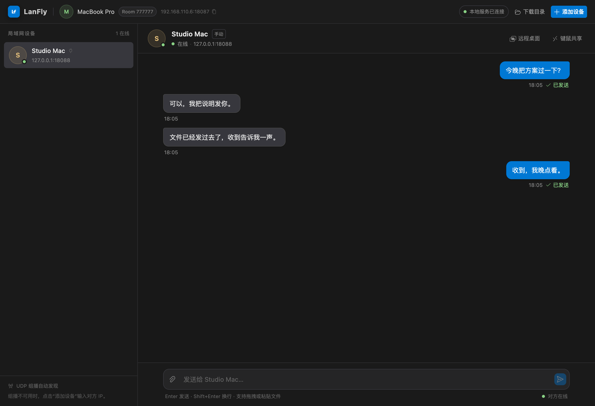

# LanFly

[English](README.md) | 简体中文

> 轻量级局域网工作台：聊天、传文件、共享键鼠（类似 Synergy）和远程桌面（类似 RustDesk）。

`lanfly` 是一个轻量的局域网工具：两台设备运行同一条命令，就能自动发现彼此，开始聊天、拖拽文件，或者直接操作另一台 Mac。不需要账号、云服务或中心服务器，浏览器就是界面。



## 能做什么

- **聊天和传文件**：文字、图片、压缩包、任意文件，拖进窗口就能发。
- **自动发现**：同一 Wi-Fi / 局域网内的设备会自动出现，也可以手动添加 IP。
- **手机和浏览器加入**：打开主机的局域网地址，就能以独立设备聊天、传文件，也能作为远程桌面的控制端。
- **共享键鼠**：两台单屏 Mac 共用一套键盘和鼠标，鼠标移到屏幕边缘即可切换，类似 Synergy。
- **远程桌面**：从另一台 Mac、手机或浏览器查看并操作被控 Mac，支持全屏、Retina 清晰采集和多档画质，类似 RustDesk。
- **Room ID 组网**：相同 Room ID 的主机才互相发现和连接。
- **不登录、不上云**：没有账号和云端存储，关闭终端后本次记录清空。

## 快速开始

1. 在第一台主机运行：

   ```sh
   npx lanfly
   ```

2. 终端会显示本机地址和 Room ID。用浏览器打开显示的地址；另一台主机运行：

   ```sh
   npx lanfly <显示的 Room ID>
   ```

3. 在左侧设备列表选择对方，就可以开始聊天、拖文件，或打开键鼠共享 / 远程桌面。

要求：Node.js 22 或更高版本；设备在同一个局域网内。macOS 的键鼠共享和远程桌面需要 macOS 12 或以上（远程桌面要求 12.3+）。

### 常用选项

| 参数             | 作用                                        |
| ---------------- | ------------------------------------------- |
| `--name <名称>`  | 设置别人看到的设备名，默认是本机 hostname   |
| `--port <端口>`  | 指定本地端口，默认 `8087`，被占用时自动顺延 |
| `--out <目录>`   | 接收文件的保存目录，默认系统下载目录        |
| `--no-open`      | 启动后不自动打开浏览器                      |
| `--no-discovery` | 禁用组播发现，仍可在网页里手动添加 IP       |
| `--verbose`      | 输出调试日志                                |

```sh
npx lanfly --name "客厅 Mac"
npx lanfly 123456
npx lanfly --out ~/Downloads/lanfly
```

## 界面语言

右上角的语言按钮支持 **简体中文 / 繁體中文 / English**。首次打开会根据浏览器语言自动选择，手动切换后会保存到本机，下次继续使用；语言不会写入 URL。

## 远程桌面（macOS）

在一台 Mac 上查看并操作另一台 Mac 的桌面。控制端可以是另一台 lanfly 主机，也可以是打开主机局域网地址的浏览器或手机。

### 使用步骤

1. 被控 Mac 在“系统设置 → 隐私与安全性”中，为运行 lanfly 的终端或 Node 进程授予 **屏幕录制** 和 **辅助功能** 权限。
2. 两台主机使用相同 Room ID 启动。控制端在设备详情或右上角点击 **远程桌面**。
3. 选择要控制的设备，按需要选择画质，然后点击 **开始远程桌面**。
4. 被控端不需要点击“接受”，连接会自动建立。被控端本机 WebUI 会打开一个状态窗口，显示是谁在查看，并可以随时点击 **停止远程桌面**。
5. 控制端可以在画面中移动鼠标、使用键盘，也可以切换全屏。鼠标键盘控制随远程桌面自动开启，不需要单独授权。
6. 连接期间双方都可以点击 **最小化** 暂时回到聊天或传文件；控制端再次点击当前聊天右上角的 **远程桌面** 即可恢复，被控端点击顶部的 **屏幕共享中** 恢复。已经连接 A 时点击 B 的远程桌面，会先确认是否结束与 A 的会话。

### 画质

- 提供 2 / 4 / 8 / 16 / 32 Mbps 五档，默认 4 Mbps。每台目标设备的画质选择会记住，下次连接时自动带出。
- 画面按 Retina 物理像素采集，最高 3840×2160，默认 30 FPS。
- 看文字、代码或设计稿建议选 **32 Mbps**；动态画面较多或无线网络一般时，16 Mbps 或 8 Mbps 更稳。
- 被控端是多显示器时，只采集主显示器。

### 注意

- 被控端没有授予屏幕录制或辅助功能权限时，远程桌面无法正常显示或控制，需要先授权。
- 同一时间只允许一个远程桌面会话；连接远程桌面会自动停止正在进行的键鼠共享，避免两套输入冲突。
- 不包含音频、剪贴板同步、文件跨屏拖拽。
- Caps Lock 会被当作受控端的输入法切换发送；macOS 可能仍会先切换控制端自己的输入法。
- 远程桌面会尝试使用 Keyboard Lock 捕获 Cmd+N/T/W 等浏览器快捷键；Safari/Firefox 或未获得锁定时，部分浏览器快捷键仍可能生效。
- 控制端使用自己的本地指针，指针形状（文本光标、缩放光标等）暂不同步；被控端本地移动鼠标时，控制端画面里也不会出现对应的指针。
- 只适用于局域网，不支持跨 NAT、VLAN、VPN 或公网。

## 共享鼠标键盘（macOS）

把两台 Mac 的键盘和鼠标连成一套。适合一台接显示器工作、另一台放在旁边的场景。

1. 两台主机使用相同 Room ID 启动，在本机 WebUI 打开 **键鼠共享**。
2. 双方分别授予运行 lanfly 的终端或 Node 进程 **辅助功能** 和 **输入监控** 权限，然后点击“刷新权限”。
3. 选择对端设备、本机角色和客户端位置，点击“连接”。一方选“服务端”时，另一方自动成为客户端。
4. 鼠标移到屏幕边缘会切换到另一台 Mac，移回相邻边缘返回。

Caps Lock 由原生键盘监听捕获并作为输入法切换发送，对端选择自己的输入源；控制端会检查并恢复本机输入源。该链路不依赖浏览器。物理按键的两机兼容性仍在实测，排查步骤见 [BUG.md](BUG.md)。

任一端按 **Ctrl + Option + Command + Esc** 或点击“停止共享”，双方都会停止。一次只连接一台设备；不包含剪贴板、文件跨屏拖拽或多指手势。仅支持 macOS。

## 手机与浏览器设备

在手机或另一台电脑浏览器打开终端显示的局域网地址，例如 `http://192.168.1.10:8087`，即可作为独立设备加入，不需要安装 Node.js。

- 浏览器设备可以聊天、传文件，也可以作为远程桌面的控制端。
- 浏览器默认使用平台名称；点击左侧自己的名称可以修改。
- 同一个浏览器、同一个访问地址会记住身份，刷新后仍是同一设备。
- 发给浏览器设备的文件会生成 30 分钟有效的下载邀请。发送页面需要保持打开；刷新、关闭页面或手机长时间切后台可能导致传输中断。
- 浏览器页面只代表浏览器设备，不能修改主机设置或配置键鼠共享。

## 发现设备

同一局域网内的 lanfly 会自动出现，通常几秒内就能在左侧看到对方。

如果对方没有出现：

1. 点击右上角 **添加设备**。
2. 输入对方 IP，例如 `192.168.1.23`；端口不是 8087 时写成 `192.168.1.23:8088`。
3. 确认双方 Room ID 一致。

手动添加的设备会保留在列表里；设备离线时显示为灰色。

## 发送文件

- 拖拽文件到聊天窗口；
- 点击输入框左侧的回形针；
- 或直接粘贴截图。

支持多选、进度显示和取消。文件从发送页面流式传输，不在中间主机缓存；重名时自动命名为 `文件 (1).ext`，不会覆盖原文件。发给主机时默认自动接收；发给浏览器时需要接收方点击下载邀请。请只在可信网络中运行。

## Room ID

Room ID 用来隔离不同的组网：只有 Room ID 相同的主机才能互相发现和连接。手机或浏览器通过局域网地址打开时，会直接加入该主机所在的组。

Room ID 只是分组标识，不是密码，也不能代替局域网本身的访问控制。

## 安全提醒

lanfly 面向可信局域网，类似 LocalSend，不是公网通信工具。

- 聊天和文件内容使用 HTTP 明文传输，同一网段内能抓包的人可以看到。
- Room ID 不是访问密码；能打开主机网页的人可以直接以浏览器设备加入。
- 远程桌面会自动接受同一 Room ID 内已发现设备的请求，并同时开启鼠标键盘控制。只应在完全可信的局域网使用；不需要共享时，及时点击被控端的“停止远程桌面”。
- 不支持跨 NAT、跨 VLAN、VPN 或公网。
- 不支持离线消息、断点续传、文件夹传输或历史记录；关闭终端后，本次会话的设备、消息和传输记录都会清空，已下载到本地的文件会保留。

## 常见问题

**看不到另一台设备？**

确认两台设备在同一网段，并允许防火墙接收 UDP `53318` 和 TCP `8087`（或实际顺延端口）。组播被禁用时，用“添加设备”手动输入 IP。

**端口被占用怎么办？**

默认从 `8087` 开始自动顺延，终端会打印实际地址；也可以用 `--port` 指定。

**远程桌面没有画面，或者鼠标键盘不动？**

先在被控 Mac 上检查“屏幕录制”和“辅助功能”权限，授权后重启运行 lanfly 的终端。权限不足时，被控端状态窗口会显示提示。

**远程桌面不够清晰？**

在画质里选择 16 Mbps 或 32 Mbps。lanfly 会按 Retina 物理分辨率采集，最高 3840×2160；如果仍然模糊，确认被控端没有使用缩放后的低分辨率显示模式。

**文件保存在哪里？**

默认 `~/Downloads`；Windows 是 `%USERPROFILE%\Downloads`。下载目录被 OneDrive 等重定向时，用 `--out` 指定目录。

**重启后聊天记录还在吗？**

不在。lanfly 只用内存保存本次运行状态，关闭终端即清空；已经下载到本地的文件不受影响。

## 开发

开发、构建、原生模块、发布流程和实现细节见 [DEVELOPMENT.md](DEVELOPMENT.md)。

## License

MIT
